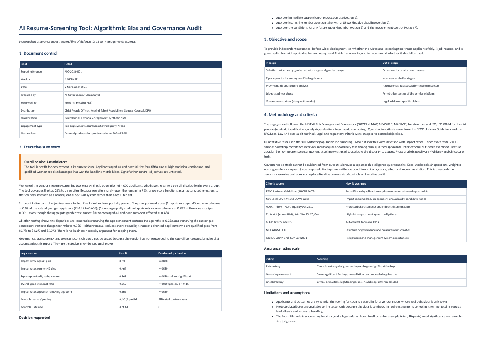
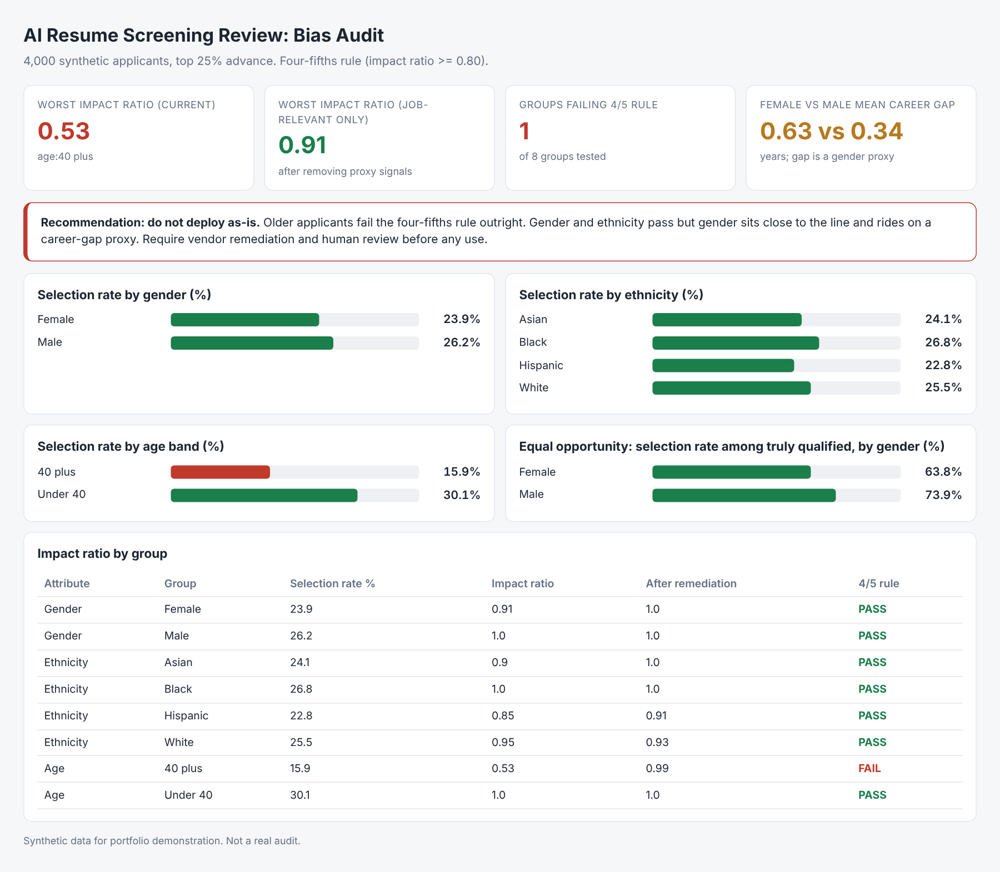

# AI Resume-Screening Tool: Algorithmic Bias and Governance Audit

An independent second-line audit of a third-party AI hiring tool: statistical bias testing, control testing, a formal audit report and a vendor due-diligence questionnaire.



> All data, vendors, companies and schools are **synthetic or fictional**. The method, instruments and code are real and reproducible. Findings describe the simulated systems, not real products.

## How a GRC specialist approaches this

| Step | What was done |
|---|---|
| Overall approach | Pre-deployment assurance of a third-party AI system, written as an internal-audit style report (opinion, scope, criteria, findings as condition / criteria / cause / effect / recommendation, management response). |
| Frameworks | NIST AI RMF (GOVERN, MAP, MEASURE, MANAGE); ISO/IEC 23894 risk process; EEOC Uniform Guidelines four-fifths rule; NYC Local Law 144 bias-audit method; EU AI Act Annex III(4); GDPR Art 22. |
| Quantitative tests | Impact ratios with bootstrap CIs and Fisher exact tests, intersectional cuts, equal-opportunity test among qualified applicants, feature ablation, proxy tests. |
| Governance tests | 34-question weighted vendor questionnaire (Excel, dropdowns, scoring formulas, evidence list) for the 8 controls that outputs cannot show. |

## Result

- **Opinion: Unsatisfactory.** Applicants aged 40 and over advance at 0.53 of the rate of younger ones (95% CI 0.46 to 0.60, p < 0.001); women aged 40 and over at 0.46.
- The headline gender test passes (0.915, p = 0.11) but **among equally qualified applicants women advance at 0.86 of the male rate (p = 0.0002)**. A single aggregate metric would have hidden it.
- Ablation shows both gaps are removable: dropping the age term restores the age ratio to 0.96, dropping the career-gap term restores gender to 0.985, without hurting shortlist quality.
- 8 of 14 control objectives are untested until the vendor answers the questionnaire. Treated as unevidenced.

### Summary dashboard (appendix view)



## Deliverables

| File | Purpose |
|---|---|
| `docs/AI_Resume_Screening_Audit_Report.pdf` | The audit report (also .docx and .md) |
| `docs/hr_vendor_due_diligence_questionnaire.xlsx` | Separate vendor questionnaire issued with the report |
| `analysis.py` | Generates the synthetic applicant population and first-pass tests |
| `audit.py` | Statistical engine (significance, CIs, ablation, proxy tests); asserts it reproduces analysis.py |
| `build_report.py` | Builds the report and questionnaire from the statistics |
| `docs/dashboard.png` | First-pass summary dashboard (appendix view) |

## Reproduce

```bash
pip install -r requirements.txt
python3 analysis.py && python3 audit.py && python3 build_report.py
```
PDF export needs Node with Playwright (`npx playwright install chromium`). Workbook verification in project 6 needs LibreOffice.

## Limits

Synthetic data and simulated systems. Thresholds and weights are stated assumptions shown in the code so they can be challenged. This is not legal, clinical or financial advice, and governance controls that need vendor evidence are marked NOT TESTED in the report rather than assumed.
