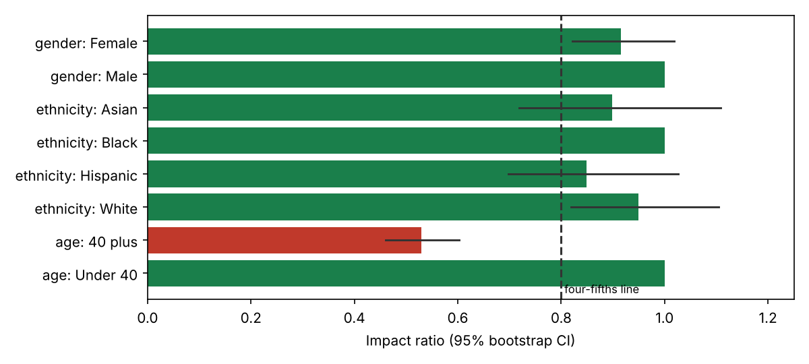
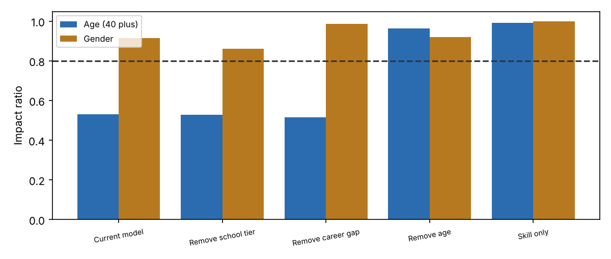

# AI Resume-Screening Tool: Algorithmic Bias and Governance Audit
*Independent assurance report, second line of defence. Draft for management response.*

## 1. Document control

| Field | Detail |
|---|---|
| Report reference | AIG-2026-001 |
| Version | 1.0 DRAFT |
| Date | 2 November 2026 |
| Prepared by | AI Governance / GRC analyst |
| Reviewed by | Pending (Head of Risk) |
| Distribution | Chief People Officer, Head of Talent Acquisition, General Counsel, DPO |
| Classification | Confidential. Fictional engagement; synthetic data. |
| Engagement type | Pre-deployment assurance of a third-party AI tool |
| Next review | On receipt of vendor questionnaire, or 2026-12-15 |

## 2. Executive summary

> **Overall opinion: Unsatisfactory**  
> The tool is not fit for deployment in its current form. Applicants aged 40 and over fail the four-fifths rule at high statistical confidence, and qualified women are disadvantaged in a way the headline metric hides. Eight further control objectives are untested.

We tested the vendor's resume-screening tool on a synthetic population of 4,000 applicants who have the same true skill distribution in every group. The tool advances the top 25% to a recruiter. Because recruiters rarely open the remaining 75%, a low score functions as an automated rejection, so the tool was assessed as a consequential decision system rather than a recruiter aid.

Six quantitative control objectives were tested. Five failed and one partially passed. The principal results are: (1) applicants aged 40 and over advance at 0.53 of the rate of younger applicants (CI 0.46 to 0.602); (2) among equally qualified applicants women advance at 0.863 of the male rate (p < 0.001), even though the aggregate gender test passes; (3) women aged 40 and over are worst affected at 0.464.

Ablation testing shows the disparities are removable: removing the age component restores the age ratio to 0.962, and removing the career-gap component restores the gender ratio to 0.985. Neither removal reduces shortlist quality (share of advanced applicants who are qualified goes from 83.7% to 84.2% and 85.7%). There is no business-necessity argument for keeping them.

Governance, transparency and oversight controls could not be tested because the vendor has not responded to the due-diligence questionnaire that accompanies this report. They are treated as unevidenced until proven.

| Key measure | Result | Benchmark / criterion |
|---|---|---|
| Impact ratio, age 40 plus | 0.53 | >= 0.80 |
| Impact ratio, women 40 plus | 0.464 | >= 0.80 |
| Equal-opportunity ratio, women | 0.863 | >= 0.80 and not significant |
| Overall gender impact ratio | 0.915 | >= 0.80 (passes, p = 0.11) |
| Impact ratio, age after removing age term | 0.962 | >= 0.80 |
| Controls tested / passing | 6 / 0 (1 partial) | All tested controls pass |
| Controls untested | 8 of 14 | 0 |

### Decision requested

- Approve immediate suspension of production use (Action 1).
- Approve issuing the vendor questionnaire with a 15 working day deadline (Action 2).
- Approve the conditions for any future supervised pilot (Action 6) and the procurement control (Action 7).

## 3. Objective and scope

To provide independent assurance, before wider deployment, on whether the AI resume-screening tool treats applicants fairly, is job-related, and is governed in line with applicable law and recognised AI risk frameworks, and to recommend whether it should be used.

| In scope | Out of scope |
|---|---|
| Selection outcomes by gender, ethnicity, age and gender by age | Other vendor products or modules |
| Equal opportunity among qualified applicants | Interview and offer stages |
| Proxy variable and feature analysis | Applicant-facing accessibility testing in person |
| Job-relatedness check | Penetration testing of the vendor platform |
| Governance controls (via questionnaire) | Legal advice on specific claims |

## 4. Methodology and criteria

The engagement followed the NIST AI Risk Management Framework (GOVERN, MAP, MEASURE, MANAGE) for structure and ISO/IEC 23894 for the risk process (context, identification, analysis, evaluation, treatment, monitoring). Quantitative criteria come from the EEOC Uniform Guidelines and the NYC Local Law 144 bias-audit method. Legal and regulatory criteria were mapped to control objectives.

Quantitative tests used the full synthetic population (no sampling). Group disparities were assessed with impact ratios, Fisher exact tests, 2,000-sample bootstrap confidence intervals and an equal-opportunity test among truly qualified applicants. Intersectional cuts were examined. Feature ablation (removing one score component at a time) was used to attribute the disparity to causes. Proxy analysis used Mann-Whitney and chi-square tests.

Governance controls cannot be evidenced from outputs alone, so a separate due-diligence questionnaire (Excel workbook, 34 questions, weighted scoring, evidence requests) was prepared. Findings are written as condition, criteria, cause, effect and recommendation. This is a second-line assurance exercise and does not replace first-line ownership of controls or third-line audit.

| Criteria source | How it was used |
|---|---|
| EEOC Uniform Guidelines (29 CFR 1607) | Four-fifths rule; validation requirement when adverse impact exists |
| NYC Local Law 144 and DCWP rules | Impact ratio method, independent annual audit, candidate notice |
| ADEA, Title VII, ADA, Equality Act 2010 | Protected characteristics and indirect discrimination |
| EU AI Act (Annex III(4), Arts 9 to 15, 26, 86) | High-risk employment system obligations |
| GDPR Arts 22 and 35 | Automated decisions, DPIA |
| NIST AI RMF 1.0 | Structure of governance and measurement activities |
| ISO/IEC 23894 and ISO/IEC 42001 | Risk process and management system expectations |

### Assurance rating scale

| Rating | Meaning |
|---|---|
| Satisfactory | Controls suitably designed and operating; no significant findings |
| Needs improvement | Some significant findings; remediation can proceed alongside use |
| Unsatisfactory | Critical or multiple high findings; use should stop until remediated |

### Limitations and assumptions

- Applicants and outcomes are synthetic; the scoring function is a stand-in for a vendor model whose real behaviour is unknown.
- Protected attributes are available to the tester only because the data is synthetic. In real engagements collecting them for testing needs a lawful basis and separate handling.
- The four-fifths rule is a screening heuristic, not a legal safe harbour. Small cells (for example Asian, Hispanic) need significance and sample-size judgement.
- The validity check is illustrative: in synthetic data the skill-only ceiling holds by construction.
- Governance controls C-07 to C-14 are untested pending vendor evidence.

## 5. Results of control testing

Each control objective was tested against the stated criteria. Results are PASS, PARTIAL or FAIL, with the test performed and the evidence relied on.

| Ref | Control objective | Test performed | Result | Evidence / finding |
|---|---|---|---|---|
| C-01 | Selection-rate impact ratio >= 0.80 for every protected group | Computed on 4,000 applicants; compared with four-fifths line | FAIL | 40 plus ratio 0.53 |
| C-02 | Disparities tested for statistical significance with confidence intervals | Fisher exact test; 2,000-sample bootstrap CI | FAIL | Age p < 0.001; gender and ethnicity not significant overall |
| C-03 | Intersectional impact tested | Gender by age cells | FAIL | Women 40 plus 0.464 |
| C-04 | Equal opportunity among truly qualified applicants | Selection rate among skill > 0.5 | FAIL | Women 0.863 of men (p < 0.001) |
| C-05 | Proxy and feature review performed | Association tests and feature ablation | FAIL | Gap and school tier act as proxies; age used directly |
| C-06 | Job-relatedness / criterion validity evidenced | Correlation of score with true skill; precision of advanced set | PARTIAL | Spearman 0.866; no vendor study (F4) |
| C-07 | Independent bias audit within 12 months published | Questionnaire section 2 | NOT TESTED | Awaiting vendor response (F5) |
| C-08 | Candidate notice and alternative process | Questionnaire section 5 | NOT TESTED | Awaiting vendor response (F5) |
| C-09 | Meaningful human oversight and override | Questionnaire section 5 | NOT TESTED | Awaiting vendor response (F5) |
| C-10 | Logging and traceability of every score | Questionnaire section 4 | NOT TESTED | Awaiting vendor response (F5) |
| C-11 | Candidate data use and retention; no training on our data | Questionnaire section 3 | NOT TESTED | Awaiting vendor response (F5) |
| C-12 | Change control and re-audit on model update | Questionnaire section 6 | NOT TESTED | Awaiting vendor response (F5) |
| C-13 | Accessibility and reasonable adjustments | Questionnaire section 5 | NOT TESTED | Awaiting vendor response (F5) |
| C-14 | Monitoring, incident handling and kill switch | Questionnaire section 6 | NOT TESTED | Awaiting vendor response (F5) |

*Figure 1. Impact ratio by group with 95% bootstrap confidence intervals*

*Figure 2. Ablation: which score component drives each disparity*

## 6. Detailed findings

### F1  Applicants aged 40 and over are screened out at roughly half the rate of younger applicants  [Critical]

| Field | Detail |
|---|---|
| **Rating** | Critical |
| **Condition (what we found)** | 40 plus applicants advance at 15.9% versus 30.1% for under 40: impact ratio 0.53 (95% CI 0.46 to 0.602, p < 0.001). The intersection of women aged 40 and over is worst at 0.464. Removing the age component from the score restores the ratio to 0.962. |
| **Criteria (what should be)** | Impact ratio of at least 0.80 (EEOC Uniform Guidelines, 29 CFR 1607.4D) and no statistically significant disparity. Age Discrimination in Employment Act protects applicants 40 and over. NYC Local Law 144 requires impact ratios to be published for the tool. |
| **Cause** | The scoring function applies an explicit age-linked penalty (in real tools this typically appears as graduation year, years of experience caps or recency weighting). Ablation shows age is the single driver: school tier and career gap leave the ratio at 0.52 to 0.53. |
| **Effect (risk)** | Disparate-impact liability under the ADEA and equivalent laws; loss of experienced talent; regulatory and reputational exposure; EU AI Act high-risk non-conformity if used in the EU. |
| **Recommendation** | Suspend production use for age-sensitive roles immediately. Require vendor to remove age-linked features and any proxies (graduation year, experience ceilings), re-run this audit and provide evidence before reinstatement. |
| **Framework references** | NIST AI RMF MEASURE 2.11; ISO/IEC 23894 6.4; EU AI Act Art. 10(2)(f) and Art. 15; EEOC UGESP |
| **Owner / target** | Head of Talent Acquisition / 2026-11-16 |

### F2  Qualified women advance less often than equally qualified men, and the headline test hides it  [High]

| Field | Detail |
|---|---|
| **Rating** | High |
| **Condition (what we found)** | Overall gender impact ratio is 0.915 (p = 0.108), which passes the four-fifths screen and is not statistically significant. Among applicants who are truly qualified, women advance at 63.8% versus 73.9% for men: ratio 0.863 (p < 0.001). |
| **Criteria (what should be)** | Equal opportunity: qualified candidates should have equal chance of progressing regardless of sex. Adverse-impact analysis should not rely on a single aggregate screen (EEOC guidance; NIST AI RMF MEASURE 2.11). |
| **Cause** | Career-gap years are penalised in the score. Women average 0.63 gap years versus 0.34 for men (p < 0.001). Removing the gap penalty lifts the gender ratio to 0.985. |
| **Effect (risk)** | Indirect sex discrimination (including caregiving-related gaps); the vendor's aggregate fairness statistic would give false assurance. |
| **Recommendation** | Remove career-gap and similar proxy features; adopt equal-opportunity difference as a mandatory reporting metric alongside impact ratio; add it to the release criteria. |
| **Framework references** | NIST AI RMF MAP 2.3, MEASURE 2.11; EU AI Act Art. 10(2)(f); Title VII; Equality Act 2010 s.19 |
| **Owner / target** | Vendor / People Analytics / 2026-12-15 |

### F3  Proxy variables are not identified or governed  [High]

| Field | Detail |
|---|---|
| **Rating** | High |
| **Condition (what we found)** | Career-gap years differ by gender (p < 0.001); school tier is associated with ethnicity (chi-square 99.7, p < 0.001, Cramer's V 0.112). Hispanic applicants sit at an impact ratio of 0.849 (95% CI 0.698 to 1.026, p = 0.098), below 0.90 but not statistically significant. |
| **Criteria (what should be)** | A documented feature review that tests every model input for association with protected characteristics, with a rationale for retaining any associated feature (ISO/IEC 23894; EU AI Act Art. 10(2)(f) and (g)). |
| **Cause** | No feature-level fairness review process was evidenced; fairness is checked, if at all, only on outputs. |
| **Effect (risk)** | Discrimination can re-enter through innocuous-looking features even when protected attributes are never used; borderline groups may breach thresholds after any model update. |
| **Recommendation** | Vendor to provide the feature list and association tests; employer to monitor the Hispanic and Asian cells monthly with sample-size-aware tests; set an alert at ratio 0.85. |
| **Framework references** | NIST AI RMF MAP 2.3, MEASURE 2.11; ISO/IEC 23894 |
| **Owner / target** | Vendor / Privacy / 2026-12-15 |

### F4  No evidence that the score is job-related (criterion validity)  [Medium]

| Field | Detail |
|---|---|
| **Rating** | Medium |
| **Condition (what we found)** | The score correlates with true skill at Spearman 0.866, and 83.7% of the people it advances are truly qualified, versus 100.0% for a skill-only ranking. (In this synthetic data the skill-only result is a by-construction ceiling; real validity must come from the vendor's studies.) No vendor validation study was provided. |
| **Criteria (what should be)** | Where adverse impact exists, the selection procedure must be validated as job-related and consistent with business necessity (UGESP 29 CFR 1607.5). EU AI Act Art. 15 requires appropriate accuracy. |
| **Cause** | Vendor claims accuracy but supplies no job-relatedness evidence. |
| **Effect (risk)** | Employer cannot defend the tool's use if challenged; a biased and not-very-predictive tool has no business case. |
| **Recommendation** | Obtain vendor validation studies; run a local validation against hire and performance outcomes before any scaled use. |
| **Framework references** | EEOC UGESP; NIST AI RMF MEASURE 2.1, 2.5; EU AI Act Art. 15 |
| **Owner / target** | People Analytics / 2027-01-31 |

### F5  Governance, transparency and oversight controls could not be tested  [High]

| Field | Detail |
|---|---|
| **Rating** | High |
| **Condition (what we found)** | Eight of 14 control objectives (C-07 to C-14) could not be tested because the vendor has not answered the due-diligence questionnaire (issued with this report). They cover independent audit, candidate notice, human oversight, logging, data use, change control, accessibility and kill switch. |
| **Criteria (what should be)** | NYC Local Law 144 (annual independent audit, candidate notice); EU AI Act Arts 12, 13, 14 and 26; GDPR Art. 22 and 35. |
| **Cause** | No pre-contract AI due-diligence step existed; the tool was piloted on a business request. |
| **Effect (risk)** | Unknown exposure. Absence of evidence is treated as non-compliance until the questionnaire is answered and evidence reviewed. |
| **Recommendation** | Vendor to return the questionnaire (workbook provided) with evidence within 15 working days. Reviewers to score and update this report. No production use until closed. |
| **Framework references** | NIST AI RMF GOVERN 1.x, 2.x; ISO/IEC 42001 8.x |
| **Owner / target** | Procurement / Legal / 2026-11-23 |

## 7. Risk assessment

Risks are scored on a 5 by 5 likelihood and impact matrix. Inherent risk assumes no controls. Residual risk assumes the controls currently in place. Bands: 20 to 25 Critical, 12 to 19 High, 6 to 11 Medium, 1 to 5 Low.

| ID | Risk | Inherent | Existing controls | Residual | Owner | Treatment |
|---|---|---|---|---|---|---|
| R1 | Age discrimination claim or regulatory action | 5x5=25 (Critical) | None | 5x5=25 (Critical) | Head of TA / Legal | Mitigate: suspend, remediate, re-audit |
| R2 | Sex discrimination via career-gap proxy | 4x4=16 (High) | None | 4x4=16 (High) | Head of TA | Mitigate: remove proxy |
| R3 | Non-compliance with NYC LL144 / EU AI Act obligations | 4x4=16 (High) | None evidenced | 4x4=16 (High) | Legal | Mitigate: close F5 |
| R4 | Recruiters over-trust the ranking (automation bias) | 4x3=12 (High) | None | 4x3=12 (High) | Head of TA | Mitigate: sample review of rejects |
| R5 | Candidate data used by vendor to train other models | 3x4=12 (High) | Unknown | 3x4=12 (High) | Privacy | Mitigate: contract clause |
| R6 | Silent model change breaches thresholds | 3x4=12 (High) | None | 3x4=12 (High) | Procurement | Mitigate: change notice and re-audit trigger |
| R7 | Tool is not predictive, so no business benefit | 3x3=9 (Medium) | None | 3x3=9 (Medium) | People Analytics | Investigate: validation study |

## 8. Recommendations and action plan

| # | Action | Addresses | Priority | Owner | Target date |
|---|---|---|---|---|---|
| 1 | Suspend production use for age-sensitive and all roles pending remediation | F1, F2 | Immediate | Head of Talent Acquisition | 2026-11-09 |
| 2 | Issue due-diligence questionnaire; collect evidence | F5 | High | Procurement | 2026-11-23 |
| 3 | Vendor removes age and career-gap features; re-submits audit stats incl. equal opportunity and intersectional cuts | F1 F2 F3 | High | Vendor / People Analytics | 2026-12-15 |
| 4 | Independent third-party bias audit; publish summary (LL144) | F1 F5 | High | Legal | 2027-01-15 |
| 5 | Local validation study against hire and performance outcomes | F4 | Medium | People Analytics | 2027-01-31 |
| 6 | Supervised pilot with 10% random review of rejected applicants, monthly impact monitoring, automatic pause below 0.80 | R4 | Medium | Head of Talent Acquisition | 2027-02-28 |
| 7 | Add AI due-diligence gate to procurement; add contract clauses (no training, change notice, audit rights) | F5 R5 R6 | Medium | Procurement / Legal | 2027-03-31 |

## 9. Management response

Responses below are drafted for the accountable owner to confirm, amend or reject. An accepted risk requires a named executive signature and an expiry date.

| Finding | Proposed response | Accept / Amend / Reject | Owner sign-off |
|---|---|---|---|
| F1 | Agree. Production use suspended pending vendor remediation; Legal to assess exposure for candidates already screened. | Pending | Pending |
| F2 | Agree. Add equal-opportunity difference to the audit standard and the vendor contract. | Pending | Pending |
| F3 | Agree. Request feature list as a condition of continued engagement. | Pending | Pending |
| F4 | Agree. Validation study scoped for Q1. | Pending | Pending |
| F5 | Agree. Questionnaire issued; response deadline set. | Pending | Pending |

## 10. Appendices

### Appendix A. Selection outcomes by single attribute

| Ref | Group | N | Selection % | Impact ratio | 95% CI | Fisher p vs reference |
|---|---|---|---|---|---|---|
|  | Female | 2023 | 23.9 | 0.915 | [0.822, 1.019] | p = 0.108 |
| Reference | Male | 1977 | 26.2 | 1.0 |  | p = 1.000 |
|  | Asian | 469 | 24.1 | 0.898 | [0.719, 1.109] | p = 0.324 |
| Reference | Black | 604 | 26.8 | 1.0 |  | p = 1.000 |
|  | Hispanic | 738 | 22.8 | 0.849 | [0.698, 1.026] | p = 0.098 |
|  | White | 2189 | 25.5 | 0.95 | [0.819, 1.104] | p = 0.528 |
|  | 40 plus | 1431 | 15.9 | 0.53 | [0.46, 0.602] | p < 0.001 |
| Reference | Under 40 | 2569 | 30.1 | 1.0 |  | p = 1.000 |

### Appendix B. Intersectional outcomes (gender by age)

| Ref | Group | N | Selection % | Impact ratio | 95% CI | Fisher p vs reference |
|---|---|---|---|---|---|---|
|  | Female / 40 plus | 723 | 14.4 | 0.464 |  | p < 0.001 |
|  | Female / Under 40 | 1300 | 29.2 | 0.944 |  | p = 0.344 |
|  | Male / 40 plus | 708 | 17.5 | 0.566 |  | p < 0.001 |
| Reference | Male / Under 40 | 1269 | 31.0 | 1.0 |  | p = 1.000 |

### Appendix C. Ablation results

| Variant | Age ratio | Gender ratio | Ethnicity ratio (min) | % of advanced who are qualified |
|---|---|---|---|---|
| Current model (all components) | 0.53 | 0.915 | 0.849 | 83.7 |
| Remove school tier | 0.527 | 0.862 | 0.903 | 88.2 |
| Remove career gap | 0.516 | 0.985 | 0.831 | 85.7 |
| Remove age | 0.962 | 0.919 | 0.856 | 84.2 |
| Skill only (job-relevant signal) | 0.991 | 0.999 | 0.911 | 100.0 |

### Appendix D. Companion documents

docs/hr_vendor_due_diligence_questionnaire.xlsx (issued to the vendor), data/applicants.csv, analysis.py and audit.py (reproducible tests), data/audit_stats.json (all statistics quoted above). The audit script asserts that it reproduces the first-stage results, to catch drift.

### Appendix E. Glossary

Impact ratio: a group's selection rate divided by the highest group's rate. Equal opportunity: equal selection chance among qualified candidates. Proxy: a feature that stands in for a protected characteristic. Ablation: removing one component to measure its effect.
